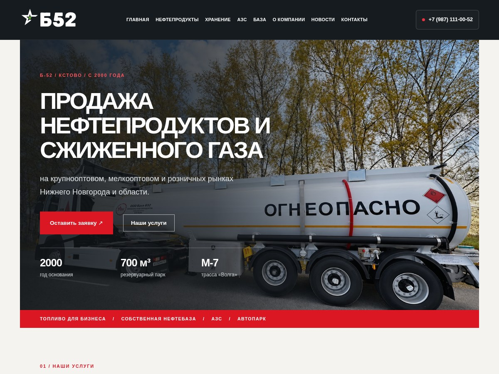
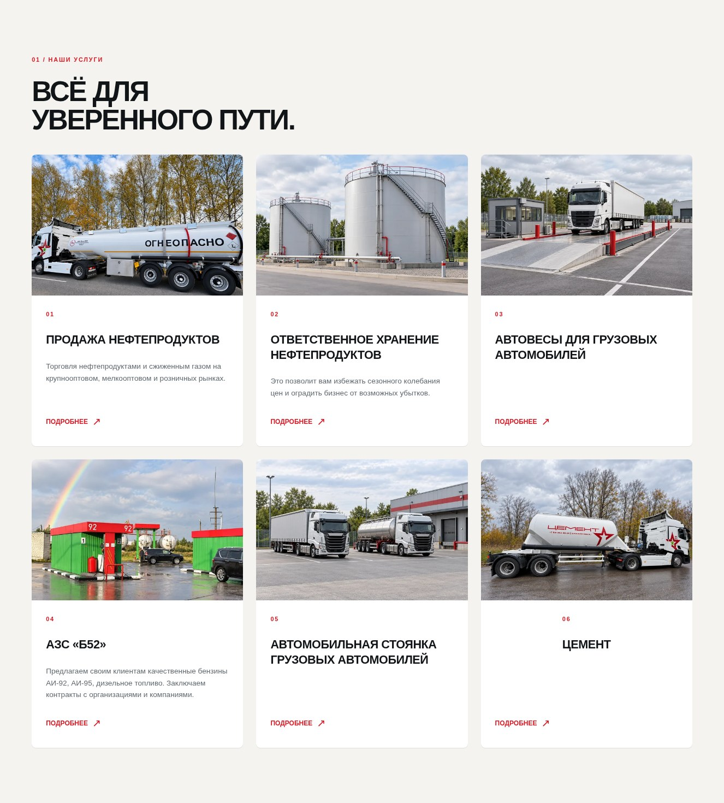

# Б-52 Industrial 2.5.0

[Скачать установочный ZIP темы — 9,0 МБ](https://raw.githubusercontent.com/timorese/sobesik/main/downloads/b52-industrial-v2.5.0/b52-industrial-v2.5.0.zip)

[Скачать исходники изображений — 33,8 МБ](https://raw.githubusercontent.com/timorese/sobesik/main/downloads/b52-industrial-v2.5.0/b52-images-originals-v2.5.zip)

- Компактный SVG-логотип без белой плашки, обновлённая шапка и кнопка телефона.
- Одинаковый формат фотографий 3:2 в карточках. Для цементовоза подготовлен отдельный кадр без полос.
- Актуальные локальные фото и единственная стела АЗС отображаются в Gutenberg. Исправлены ошибки блоков изображений; при обычном сохранении новые ссылки сохраняются в базе.
- Лёгкая анимация появления и наведения с учётом уменьшения движения. Фото главного баннера сохранено.

Загрузите ZIP темы в WordPress как замену установленной версии, очистите кеш и заново откройте редактор. Повторный импорт не нужен. Тексты, пользовательские фотографии и сохранённые цены сохраняются. Архив исходников изображений устанавливать как тему не нужно.

Проверено локально: 13 страниц на пяти ширинах, Gutenberg для всех 13 страниц, сохранение и повторное открытие главной и АЗС, 37 внутренних ссылок, 29 проверок цен и прав доступа. Рабочий хостинг не обновлялся.

[Инструкция по обновлению](UPDATE-RU.md) · [Редактору цен](EDITOR-PRICES-RU.md) · [Проверки и ограничения](TEST-REPORT.md) · [Изменения](CHANGELOG-RU.md) · [Источники изображений](IMAGE-SOURCES-RU.md) · [SHA-256](checksums.json)

