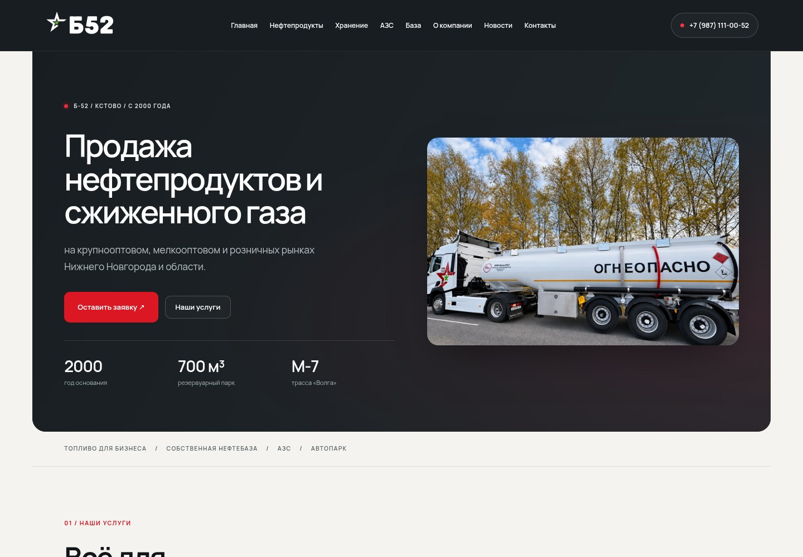
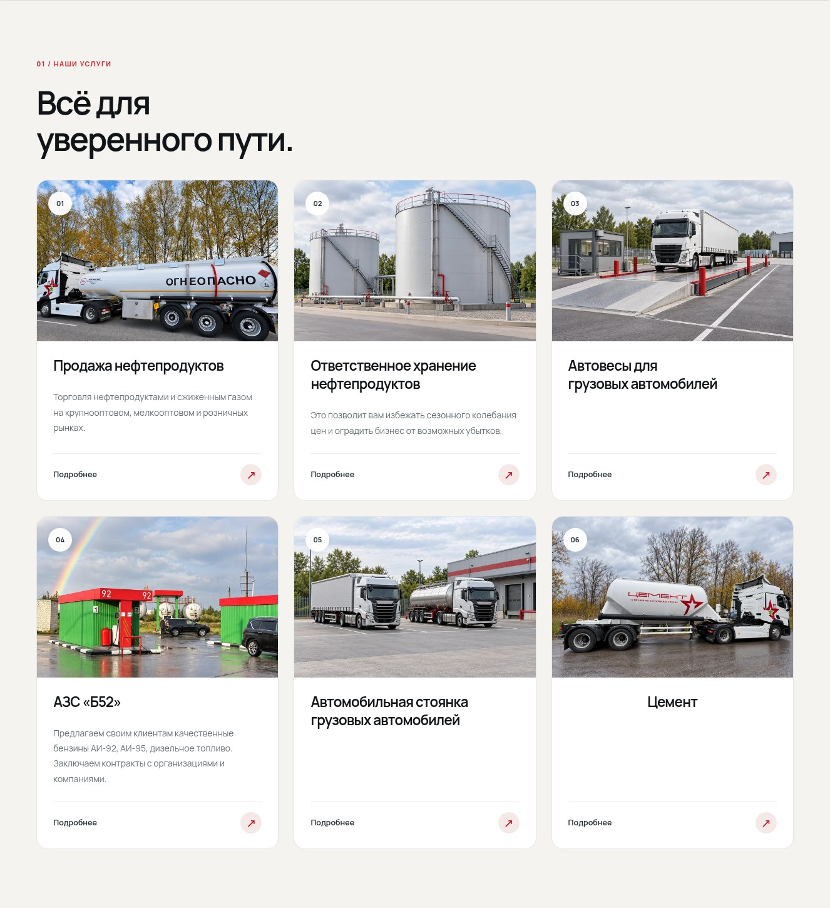
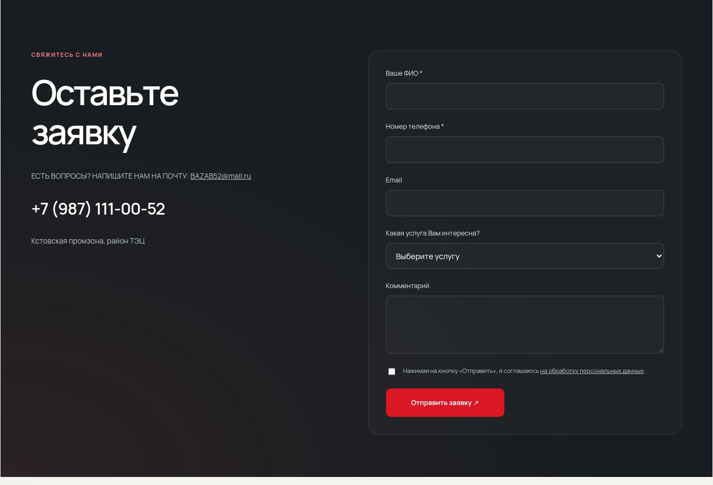
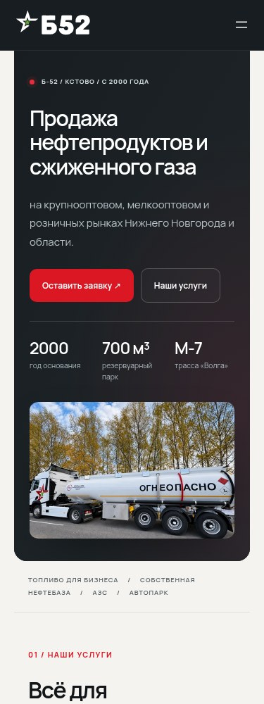

# Б-52 Industrial 2.6.0

[Скачать установочный ZIP темы — 8,4 МБ](https://raw.githubusercontent.com/timorese/sobesik/main/downloads/b52-industrial-v2.6.0/b52-industrial-v2.6.0.zip)

- Локальный шрифт Manrope с кириллицей, спокойная типографика и больше свободного пространства.
- Главный экран с текстом и самостоятельным фотоблоком. Вертикальная компоновка на телефоне.
- Закреплённая шапка и переходы к секциям с учётом её высоты.
- Обновлённые карточки услуг, блоки компании и принципов, тёмная панель формы заявки и подвал.
- Деликатные эффекты появления и наведения. Поддержка уменьшения движения и работы без JavaScript.
- Актуальные фото в Gutenberg, один блок стелы АЗС, сохранение контента и цен.

Загрузите ZIP поверх установленной темы, очистите кеш и заново откройте редактор. Повторный импорт не нужен. Рабочий сайт автоматически не обновляется.

[Обновление](UPDATE-RU.md) · [Проверки и ограничения](TEST-REPORT.md) · [Изменения](CHANGELOG-RU.md) · [Редактору цен](EDITOR-PRICES-RU.md) · [SHA-256](checksums.json)

Фотографии сохранены из 2.5: [архив исходников изображений](https://raw.githubusercontent.com/timorese/sobesik/main/downloads/b52-industrial-v2.5.0/b52-images-originals-v2.5.zip).

## Главная

## Карточки услуг

## Форма заявки

## Мобильный вид

