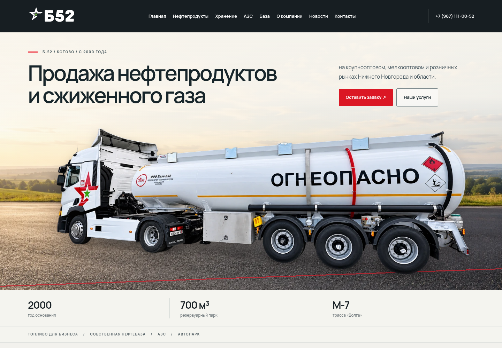

# Б-52 Industrial 3.1.0

- [Скачать ZIP темы — 9,7 МБ](https://raw.githubusercontent.com/timorese/sobesik/main/downloads/b52-industrial-v3.1.0/b52-industrial-v3.1.0.zip)
- [Скачать исходные изображения — 38,2 МБ](https://raw.githubusercontent.com/timorese/sobesik/main/downloads/b52-industrial-v3.1.0/b52-images-originals-v3.1.zip)
- [Посмотреть движение](./preview-motion.webm)

Главный экран получил светлое небо, тёплый горизонт и асфальт. Фон движется медленнее бензовоза, создавая глубину; на мобильном движение уменьшено. При reduced-motion всё статично. Изображение автомобиля, его надписи, логотипы, цены и функционал сохранены из версии 3.0.

[Вид на телефоне](./preview-mobile.png) · [Инструкция по обновлению](./UPDATE-RU.md) · [Проверки и ограничения](./TEST-REPORT.md) · [Источники изображений](./IMAGE-SOURCES-RU.md) · [Контрольные суммы](./checksums.json)

Загрузите ZIP темы поверх установленной и очистите кеш. Повторный импорт страниц не нужен. Рабочий сайт автоматически не обновляется.
